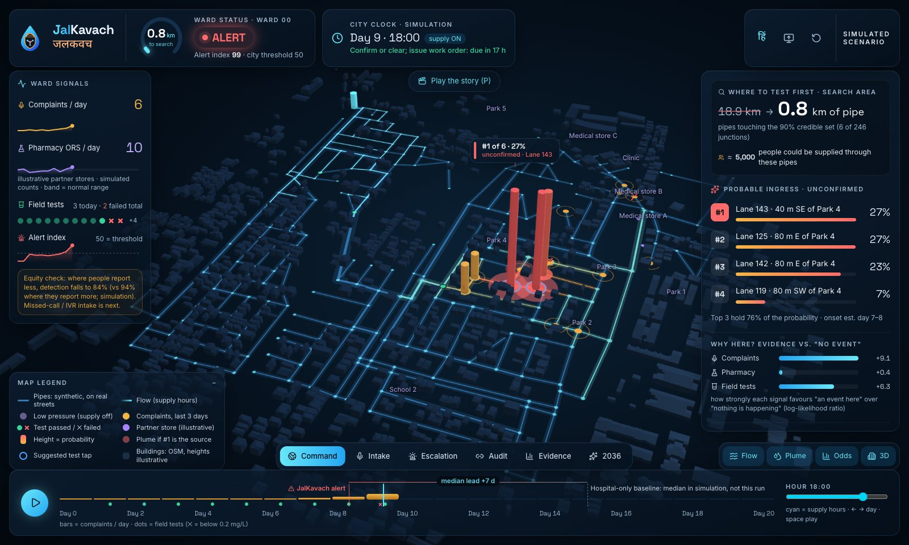
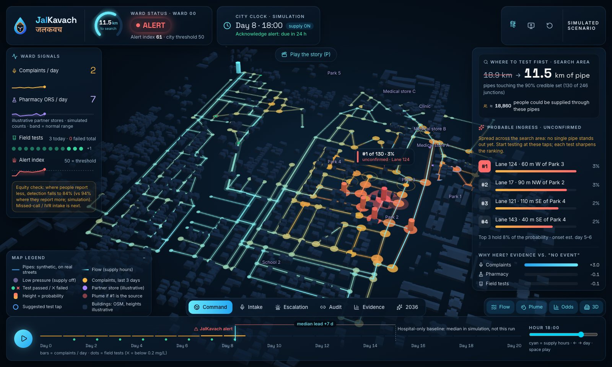
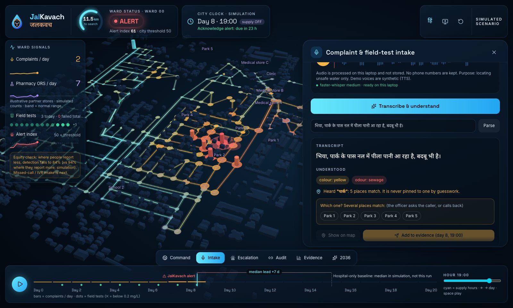
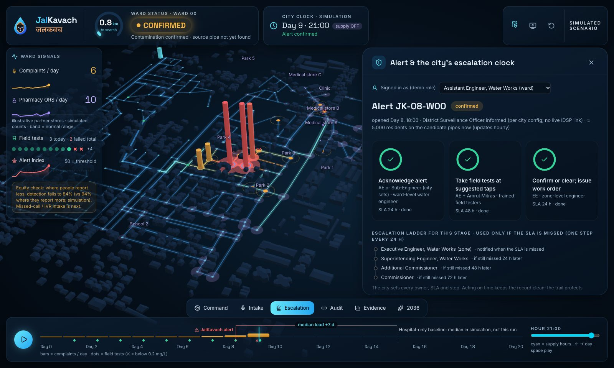
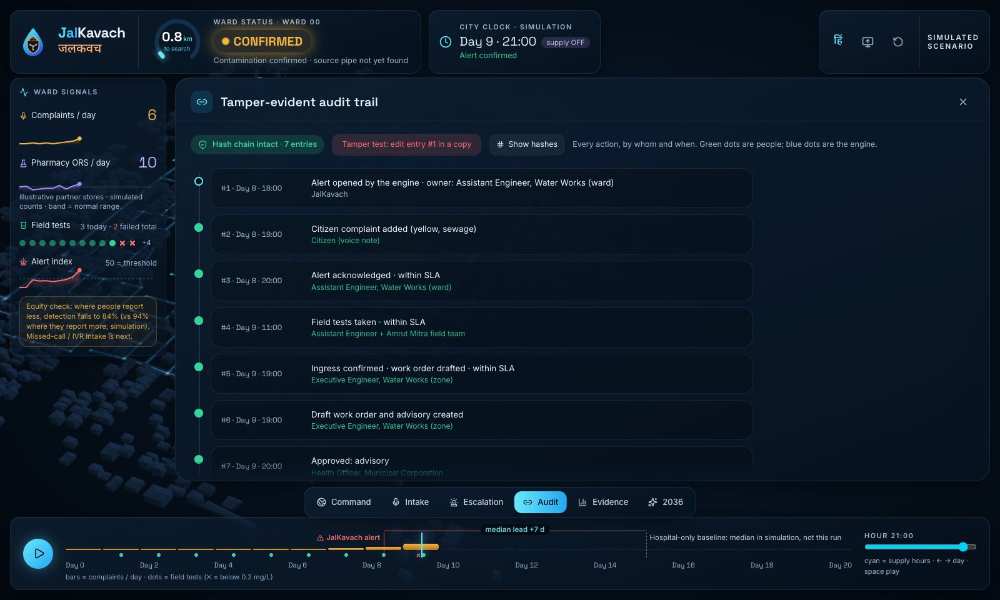
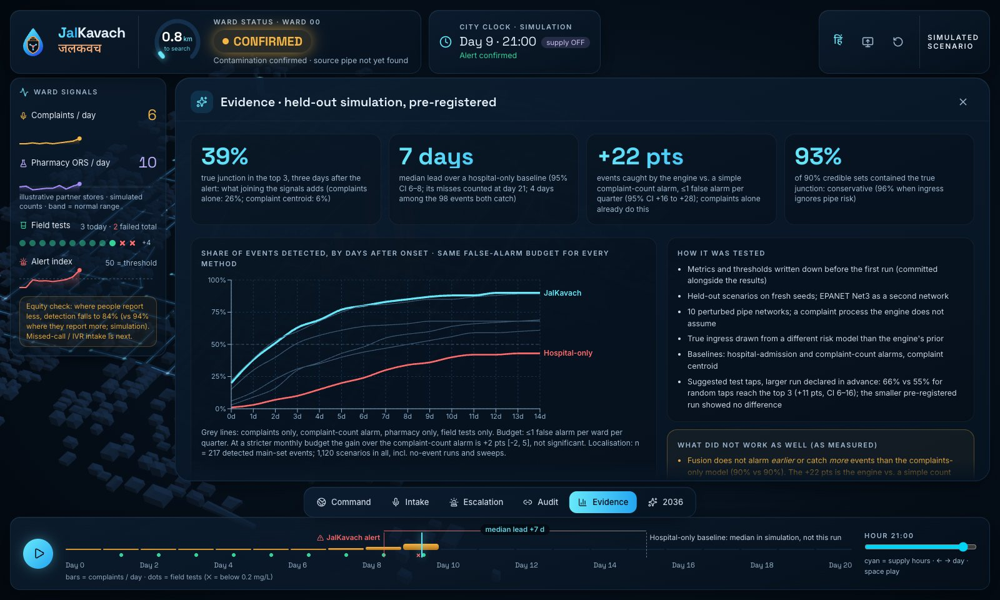
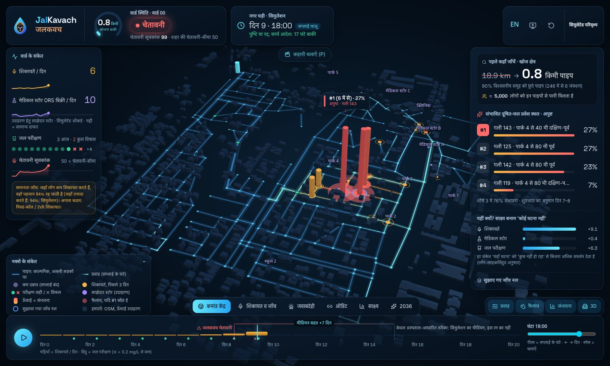
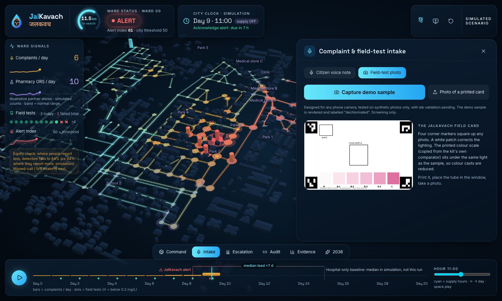
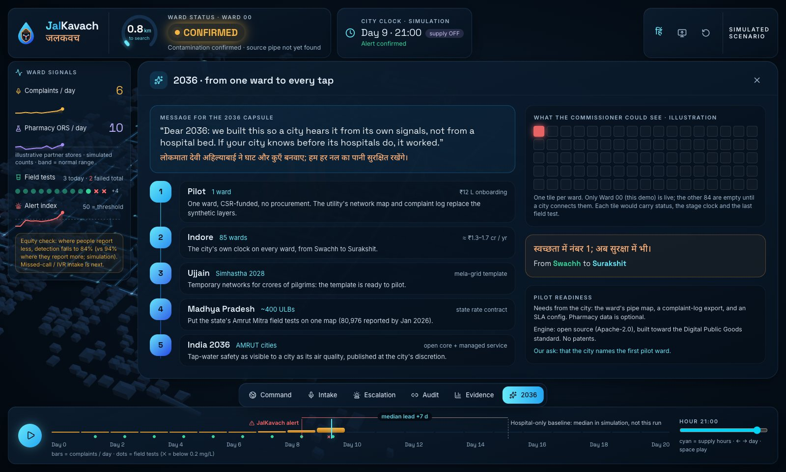
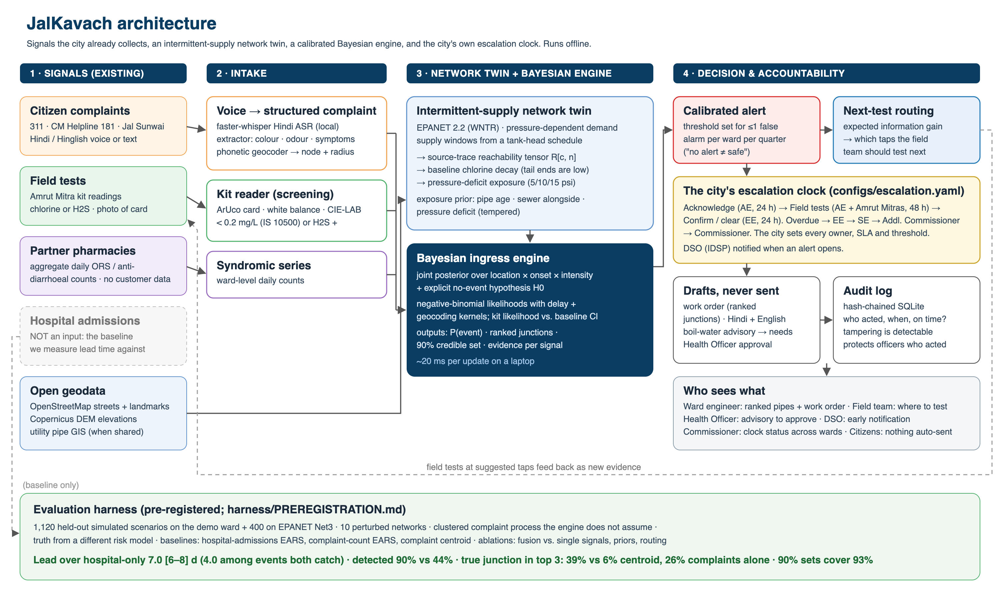

<p align="center">
  
</p>

<h1 align="center">JalKavach · जलकवच</h1>

<p align="center"><b>Know before the hospitals do.</b><br>
Early warning and pipe localisation for sewage getting into a city's drinking water.<br>
Built for Indore · BUILD 2036 (TiE Global Summit 2026) · Frontier 06: The Rise of New India</p>

<p align="center">
  <a href="https://youtu.be/-0dS_VIg2MM"></a>
  <!--LIVE_BADGE-->
  <a href="results/RESULTS.md"></a>
  <a href="LICENSE"></a>
</p>

<p align="center"></p>

> **Prototype.** The streets, landmarks and elevations are real (Nipania, Indore). The pipe network, complaints, field tests and pharmacy counts are simulated, and so is every performance number below. It is not field data.

## Links for judges

| What | Where |
|---|---|
| ▶ **Demo video** (95 s, narrated) | https://youtu.be/-0dS_VIg2MM |
| 🌐 **Live demo** | <!--LIVE_ROW--> |
| 📑 **Submission deck** (PDF) | [docs/JalKavach_BUILD2036_Submission.pdf](docs/JalKavach_BUILD2036_Submission.pdf) |
| 📊 **Evaluation results**, every number with its interval | [results/RESULTS.md](results/RESULTS.md) |
| 🧾 **Pre-registration** and change log, written before the first run | [harness/PREREGISTRATION.md](harness/PREREGISTRATION.md) |
| 💧 **Impact case**: the problem, cost of one event, adoption path | [docs/IMPACT_CASE.md](docs/IMPACT_CASE.md) |
| 🤝 **Pilot pack**: partners, request letter, FAQ | [docs/PILOT_PACK.md](docs/PILOT_PACK.md) |
| 🧭 **Architecture** | [below](#architecture) · [SVG](docs/architecture.svg) |
| ⚙️ **City escalation policy** (owners, SLAs, chain) | [configs/escalation.yaml](configs/escalation.yaml) |
| 💻 **Run it yourself** in one command | [below](#run-it-locally) |

## The problem

In December 2025, sewage got into a drinking-water line in a ward of Indore. Press reports describe weeks of foul-water complaints before hundreds of people were hospitalised. The warnings existed. They arrived as separate tickets on helplines, in ward offices and in field tests, and no system joined them up, placed them on a pipe map or escalated them.

Indian cities run **intermittent supply**: pipes sit at low pressure for most of the day, often in the same trench as sewers, which is when sewage gets in. Urban networks have **no continuous water-quality sensing**. Madhya Pradesh's 9,801 Amrut Mitras ran 80,976 ward-level tests after the outbreak, and we found no public record that pools them. Sources and ranges are in the [impact case](docs/IMPACT_CASE.md).

## What JalKavach does

It joins the signals a city **already collects** into one ward-level alert:

- **Signals:** citizen complaints (311, CM Helpline 181, Jal Sunwai, Hindi voice notes), Amrut Mitra field tests, and aggregate ORS sales from partner pharmacies where they agree to share them.
- **Engine:** a Bayesian model on an EPANET twin of the ward's intermittent supply weighs every pipe junction and onset day against an explicit *"nothing is happening"* hypothesis. Its threshold is calibrated to at most one false alarm per ward per quarter.
- **Each alert carries:**
  - **where to test first**: the 90% credible set as kilometres of pipe, ranked junctions, residents on those pipes, and suggested test taps
  - **a clock the city sets**: an owner and a deadline for every stage, with automatic escalation when a stage is missed
  - **drafts, never sent**: a work order and a Hindi/English advisory that the Health Officer approves
  - **a tamper-evident audit trail** that shows who acted, and when
- **People decide.** When a voice note says "near the park" and five parks match, the officer confirms which one; nothing is pinned by guesswork.

## See it

| | | |
|---|---|---|
|  **Alert day:** the search opens at 11.5 of 18.9 km |  **Hindi voice note:** several parks match, so the officer confirms |  **Next day:** field tests narrow it to 0.8 km |
|  **The city's clock:** every stage on time |  **Hash-chained audit trail** with a live tamper test |  **Evidence**, including what did not work |
|  **Full Hindi mode** with IMC designations |  **Field-test card reader** (screening) |  **2036:** from one ward to every tap |

## Architecture



| Layer | What it does | Real or simulated |
|---|---|---|
| **Network twin** | Builds the street graph from OpenStreetMap, lays a pipe network along it, and runs EPANET 2.2 (via WNTR) with **pressure-dependent demand** and **intermittent supply windows**. One source-trace run per candidate ingress point gives a reachability tensor R[c, n]; chlorine decay gives each tap's normal level. | Streets, landmarks, elevation (Copernicus DEM): **real**. Pipes, sewers, ages: **synthetic**, seeded, constrained to the streets. Landmarks get generic labels only; places of worship are never used. |
| **Exposure prior** | Scores each junction by pipe age, sewer alongside and *pressure-deficit hours* (swept over 5/10/15 psi), after Kumpel & Nelson's intermittent-supply field work. | Derived |
| **Bayesian engine** | Joint posterior over *(location × onset day × intensity)* plus a **no-event** hypothesis. Negative-binomial likelihoods for complaints and pharmacy counts with delay and geocoding kernels; kit-agnostic field tests (chlorine read at once, H2S next day); low chlorine at tail ends is modelled as normal. About 20 ms per update on a laptop. | — |
| **Escalation** | The city sets owners, SLAs and the chain in [`configs/escalation.yaml`](configs/escalation.yaml). JalKavach runs the clock, requires a reason when a stage is late, drafts the work order and the advisory, and records everything in a hash-chained SQLite log. | — |
| **Intake** | Hindi speech recognition on the machine itself (faster-whisper), extraction of colour, odour, symptoms and place that tolerates ASR spelling variants, and phonetic fuzzy matching to OSM landmarks. Ambiguous places are never auto-pinned. | Demo voice clips are synthetic (TTS) |
| **Field-test reader** | A printable card with ArUco markers: perspective correction, white balance, CIE-LAB matching against the kit's scale, screening at the IS 10500 limit of 0.2 mg/L free chlorine, or H2S vial blackening. | Validated on synthetic photos only; lab validation pending |

Hospital admissions are **not** an input. They are the baseline that lead time is measured against.

## Results

Simulated, held-out, and **pre-registered** before the first run ([`harness/PREREGISTRATION.md`](harness/PREREGISTRATION.md)). The test scenarios use 10 perturbed networks, a clustered complaint process the engine does not assume, continuous intensities, and true ingress points drawn from a risk model whose form differs from the engine's prior: 720 event and 400 no-event scenarios on the demo ward. 95% bootstrap CIs in brackets.

| At ≤1 false alarm per ward per quarter | Result |
|---|---|
| Alarm lead over a hospital-admissions-only baseline (median, paired; its misses counted at day 21) | **7.0 [6.0–8.0] days** · 4.0 [3.0–5.0] among the 98 events both catch |
| Events detected within 21 days: JalKavach vs. hospital-only | **90%** vs. 44% |
| True junction (of 246) in the top 3, three days after the alarm: joined signals vs. complaints alone vs. complaint centroid | **39%** vs. 26% vs. 6% |
| Events caught by the engine minus a simple complaint-count alarm (paired) | **+22 [16–28] points** (at ≤1 false alarm per *month*: +2, not significant) |
| Coverage of the 90% credible set | 93% [89–96] |
| Robustness network (EPANET Net3): lead; top-3 | 5.0 [4.0–6.0] days; 68% |
| Suggested test taps vs. random taps (larger run, declared before it ran; 280 events) | 66% vs. 55% reach the top 3, **+11 [6–16] points** (the smaller pre-registered run showed no difference) |

**What did not work as well, reported as measured:**
- **Timing and counts:** joining signals alarms no earlier and catches no more events than complaints alone (90% vs. 90%). Its gain is **where**: 39% vs. 26% top-3.
- **Intermittent-supply prior vs. a 24×7 prior:** +3.2 points top-3, CI −0.9 to +7.4. Not significant.
- **Ward size:** 39% top-3 on this 246-junction ward vs. 68% on the smaller Net3. Bigger wards need more field tests.
- **Equity:** where the exposed population reports less, detection falls to 84% (94% where they report more). Missed-call / IVR intake is the next step.
- **Geocoding precision:** top-3 is 20% with 250 m geocoding error and 60% at 60 m, which is why ambiguous landmarks go to a person.
- **Small exposures:** ingress reaching only a few dozen residents is rarely detectable from complaints; routine tests remain the safeguard.

**Every demo ward we used is reported.** The ward moved twice, for reasons unrelated to results (see the change log):

| Demo ward (as reported at the time) | Junctions | Lead vs. hospital | Detected | vs. count alarm | Top-3 (centroid) |
|---|---|---|---|---|---|
| 1st: site of a real 2025–26 outbreak, withdrawn | 84 | 7.0 [6–8] d | 94% | +13 [8–18] | 67% (12%) |
| 2nd: old-city ward, withdrawn as politically sensitive | 146 | 5.0 [4–6] d | 85% | +16 [11–21] | 57% (13%) |
| **3rd: Nipania (current)** | 246 | **7.0 [6–8] d** | **90%** | **+22 [16–28]** | **39% (6%)** |

Reproduce with `make eval` (about 3 minutes on 8 cores), then `make report`.

## Engineering notes

- **State is a pure function of (day, hour, recorded actions).** Scrubbing the timeline back and forth is always consistent, and every view can be deep-linked: `/?view=command&day=9&hour=18&lang=hi`.
- **Causal by timestamp.** Evidence counts only from the moment it was recorded, so late evidence never rewrites an earlier evaluation (tested).
- **One scenario per visitor.** On a shared deployment each browser tab sends its own session id, so judges never see each other's complaints or actions (tested).
- **Calibrated, not tuned.** Alert thresholds come from null scenarios at the false-alarm budget; the held-out seeds were never used for development.
- **Accountability by construction.** Actions after a missed deadline need a reason, enforced on the server; the audit log is hash-chained and the UI has a live tamper test.
- **Bilingual.** Every screen works in Hindi, including Indore Municipal Corporation designations and the advisory text.
- **Tested.** 41 tests (engine, harness, service, product, sessions) run offline in CI; `make demo-check` exercises every endpoint, the story path, live Hindi transcription and the build.

## Run it locally

Works on macOS, Linux and Windows. Everything runs offline after setup; the built web app is committed, so Node is only needed to change the front end.

**Option A: Python with [uv](https://docs.astral.sh/uv/)** (recommended)

```bash
git clone https://github.com/TusharTechs/jalkavach.git
cd jalkavach
uv sync --frozen --extra voice      # Python 3.12 and pinned dependencies (uv installs Python if needed)
uv run uvicorn app.server:app --port 8036
```

Open http://localhost:8036. The first Hindi transcription downloads the speech model once (about 1.5 GB for `medium`; set `JALKAVACH_ASR_MODEL=small` for a 480 MB model).

On macOS or Linux the same steps are wrapped in `make`:

```bash
make setup   # uv sync
make app     # command centre at http://localhost:8036
make test    # offline tests
make eval    # re-run the pre-registered evaluation, then: make report
```

**Option B: Docker** (any OS)

```bash
docker build -t jalkavach .
docker run -p 8036:8036 jalkavach
```

**Front end development** (Node 22 + pnpm): `cd web && pnpm install && pnpm dev`, or `make web` to rebuild `web/dist`.

**Presenter controls:** `P` plays the narrated story (about 90 s) · `←`/`→` change the day · `space` plays or pauses · `1`–`6` switch views · `S` stage mode · `H` Hindi · `R` reveals the simulated truth.

## Repository map

```
app/            FastAPI server (API + the built web app)
src/jalkavach/  engine: network twin, hydraulics, prior, posterior, signals, intake, kit reader, escalation, service
harness/        pre-registered evaluation, report, routing extension
results/        RESULTS.md, summaries, per-event CSVs, figures
web/            React + deck.gl command centre (source in web/src, build in web/dist)
configs/        demo ward and the city's escalation policy
data/           cached OSM / elevation / hydraulics, demo scenario and voice clips
docs/           architecture, impact case, pilot pack, screenshots, submission deck
scripts/        demo check, narrated video recorder
tests/          pytest suite
```

## Honest limitations

- The pipe topology is synthetic: constrained to real streets, but not the utility's network. One ward's network map and complaint log replace the synthetic layers.
- Every performance number comes from simulation, not field data. The harness uses model mismatch and a complaint process the engine does not assume, so the model is not graded on its own assumptions. Scenario parameters are assumptions, documented in `src/jalkavach/signals.py` and swept where it matters.
- EPANET Net3 is a standard benchmark used for robustness only; it is not an Indian network. EPANET is a full-pipe solver: we do not simulate pipes draining and refilling.
- "No alert" does not mean "safe".

**Prior work we build on:** the US EPA's Water Quality Surveillance and Response System pilots (multi-signal contamination warning) and the Bayesian source-identification literature. JalKavach adapts them to chronic ingress on intermittent Indian networks, adds the city's own escalation clock and Hindi intake, and measures its contribution with ablations.

## AI tools and technologies used

<sub>
<b>In the product:</b> Bayesian inference (NumPy/SciPy), EPANET 2.2 via WNTR, faster-whisper for Hindi speech recognition (open model, runs on the machine running JalKavach), OpenCV for the kit reader, expected-information-gain test routing. No model writes advisories or decides alerts; people approve every draft.<br>
<b>Stack:</b> Python 3.12, FastAPI, OSMnx, React 19, TypeScript, Vite, Tailwind v4, deck.gl 9, Motion, Recharts, pytest, GitHub Actions, uv, Docker.<br>
<b>While building:</b> Claude Code (Anthropic) as a coding and review assistant; Sarvam Bulbul for the demo video's narration voice; macOS text-to-speech for the synthetic demo voice clips.
</sub>

## License

[Apache-2.0](LICENSE). No patents are filed or planned: the engine is meant to be reused by any city, toward the Digital Public Goods standard.
